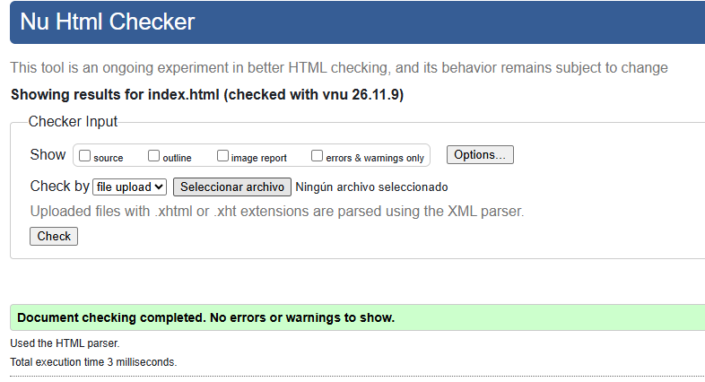
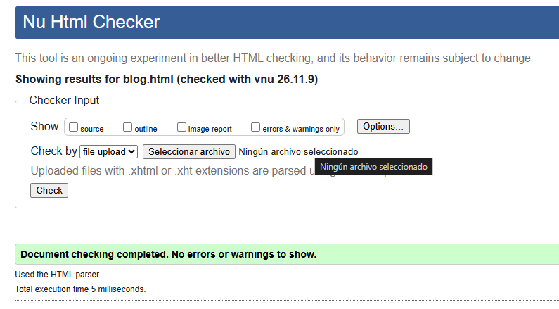
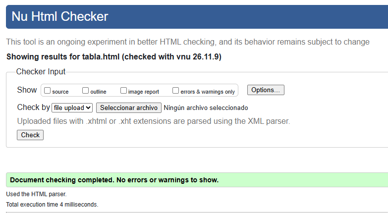
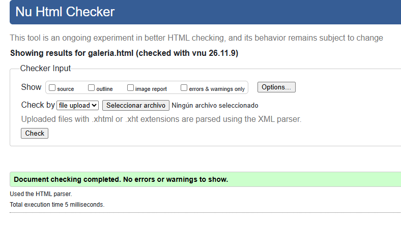
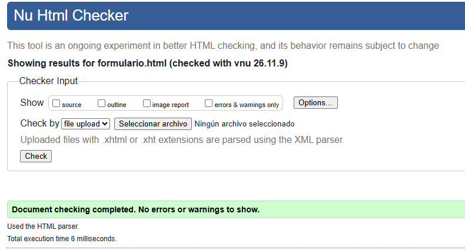
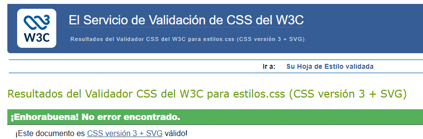
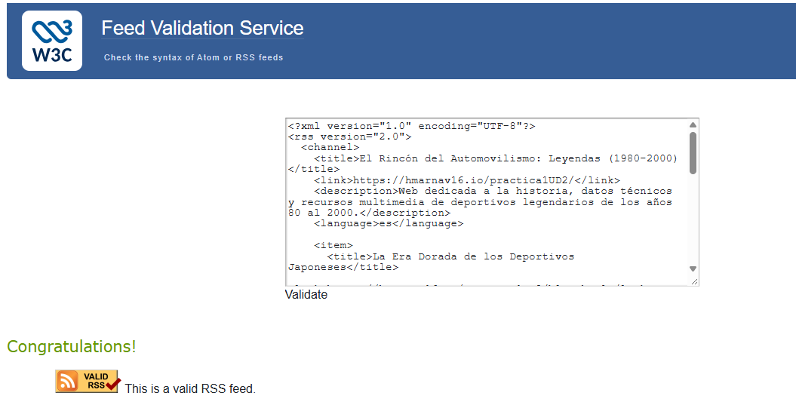

# El Rincón de Automovilismo: Leyendas (1980-2000) 

## Autoría 
- Nombre y apellidos: Héctor Javier Martínez Navas-Parejo 
- Curso: 1º DAM
- Módulo: Lenguajes de Marcas y Sistemas de Gestión de Información (LMSGI) 
- Fecha: 9 de Noviembre 2026 

## Sitio publicado 
- Web en GitHub Pages: [Abrir sitio](https://hmarnav16.github.io/practica1UD2/)
- Repositorio en GitHub: [Abrir repositorio](https://github.com/hmarnav16/practica1UD2)

## Estructura del proyecto 
- \`index.html\`: Página principal con resúmenes de contenidos de deportivos JDM. 
- \`blog.html\`: Artículo sobre la historia de los deportivos japoneses (1980-2000). 
- \`tabla.html\`: Información tabular comparativa de motores y sus potencias. 
- \`galeria.html\`: Galería multimedia con imágenes, audios y videos de automóviles deportivos. 
- \`formulario.html\`: Formulario de registro en el club.
- \`rss.xml\`: Canal RSS 2.0 con contenido actualizado. 

## Tecnologías utilizadas 
- HTML5 
- CSS
- XML y RSS 
- Git 
- GitHub 
- GitHub Pages 

## Características principales 
- Navegación entre 5 páginas distintas. 
- Uso de HTML semántico. 
- Tabla de datos accesible. 
- Galería con varios formatos de imagen. 
- Contenido multimedia local. 
- Formulario estructurado con validación HTML5. 
- Canal RSS. 

## Validación

### HTML

### CSS

### RSS

## Decisiones técnicas
- Cada documento se ha realizado en una rama distinta.

## Fuentes y licencias 
- El video 'ToyotaSupra.mp4' pertenece al video original https://www.youtube.com/watch?v=PSukCXnDEUA&t=42s del canal 'NM2255 | Raw Car Sounds'.
- El audio 'motorSupra.m4a' pertenece al video original https://www.youtube.com/shorts/YIicVw7LClE del canal 'Pintsandpetrol'.